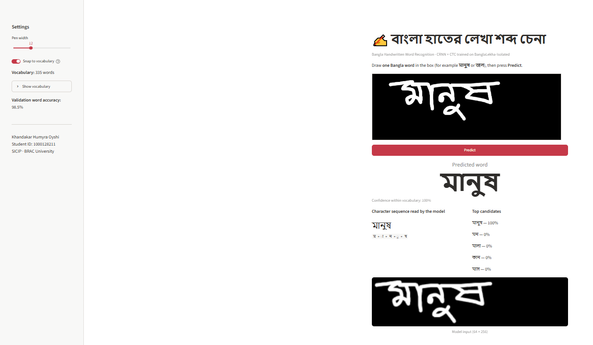
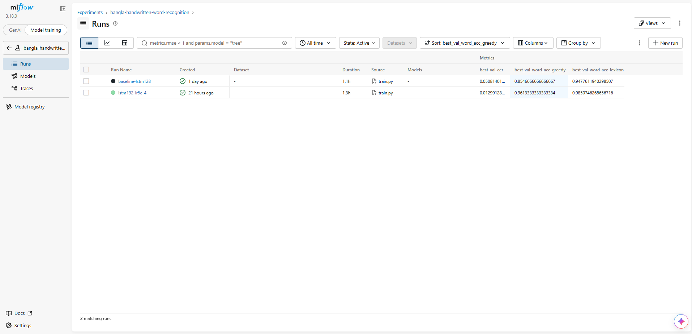

# Bangla Handwritten Word Recognition System
### Assignment 04 · Skills for Industry Competitiveness and Innovation Program (SICIP), BRAC University

| | |
|---|---|
| **Name** | Khandakar Humyra Oyshi |
| **Student ID** | 1000128211 |
| **Repository** | https://github.com/HuOyshi/MLDLassignment4 |

---

## 1. What it does
You draw **one Bangla word** on a canvas in the browser, and the app shows the **whole predicted word**:
a drawing of **মানুষ** is predicted as **মানুষ**, and a drawing of **জল** as **জল**. The model is trained from the
[BanglaLekha-Isolated](https://data.mendeley.com/datasets/hf6sf8zrkc/2) dataset, every training run is tracked in
**MLflow**, the interface is built with **Streamlit**, and the app runs in **Docker**.



## 2. Approach

### 2.1 The problem: a character dataset for a word task
BanglaLekha-Isolated contains about 166k images of **isolated characters**: 50 basic characters, 10 numerals and
24 compound characters, written by around 2,000 people. It has **no word images** and **no vowel signs (কার)** such
as া ি ী ু ূ ে ো. A plain character classifier would only output separate characters, which the assignment does not
accept. So I built a model that reads a whole word image and outputs the whole word.

### 2.2 Synthetic word images built from the dataset
`train.py` creates training words on the fly from the vocabulary in `words.txt` (~330 common words, including
মানুষ and জল). Each word image comes from one of two sources:

1. **Handwritten composites (about 60%).** For each letter of the word, a random BanglaLekha image of that
   letter is picked, so one word mixes the handwriting of several people. The letters are placed side by side,
   joined by a continuous **matra** (headline), and the vowel signs are drawn as pen strokes in the correct
   position: ি ে ৈ before the consonant, া ী after it, ু ূ ৃ below it, and ো split around it. The dataset has no
   vowel-sign images, so I generate them as strokes.
2. **Font renders (about 40%).** The same words are rendered with 9 open-source Bangla fonts (Google Fonts, OFL
   licence) using proper text shaping, then thickened and warped to look handwritten. This covers vowel signs and
   conjuncts (যুক্তাক্ষর, e.g. বৃষ্টি, সন্ধ্যা) that cannot be composed from the dataset.

Every image is then augmented with rotation, shear, scaling, elastic distortion, stroke thickening or thinning,
and blur. It is cropped to the ink, scaled to 64 × 256 pixels with its aspect ratio kept, and shown as white ink
on black, the same way the app treats the canvas drawing (`ocr_utils.preprocess`).

The character images are split **85% / 15% per class before** any words are built. Validation words therefore
use handwriting the model never saw during training.

### 2.3 Model: CRNN + CTC
| Part | Details |
|---|---|
| Input | 64 × 256 grayscale word image |
| CNN | 4 blocks of 2 × (Conv 3×3 + BatchNorm + ReLU) with 32/64/128/256 filters; pooling (2,2),(2,2),(2,1),(2,1) |
| Sequence | 64 time steps (one per 4-pixel column strip), Dense 256 + Dropout |
| RNN | 2 × Bidirectional LSTM |
| Output | softmax over the Bangla characters + a CTC "blank" |
| Loss | CTC (Connectionist Temporal Classification) |

CTC lets the network learn the character sequence of the whole word **without anyone marking where each letter
starts and ends**. This matters because handwritten Bangla letters are joined by the matra.

### 2.4 From characters to a whole word
1. **Greedy CTC decoding** reads the most likely character sequence (shown in the app as "character sequence").
2. **Vocabulary matching:** the app computes the CTC likelihood of every word in the vocabulary for the drawing
   and shows the most likely one as the **predicted word**, together with the top-5 candidates and their relative
   confidence. A small spelling slip in step 1 (e.g. মানূষ) still gives the right word. This can be switched off
   in the sidebar to see the raw output.

### 2.5 Experiment tracking with MLflow
Each `python train.py` run logs to the MLflow experiment `bangla-handwritten-word-recognition` (stored in
`artifacts/mlflow/`):
- **parameters:** epochs, learning rate, batch size, LSTM size, dropout, font ratio, vocabulary size, model size …
- **metrics per epoch:** training and validation CTC loss, character error rate (CER), word accuracy (greedy) and
  word accuracy (with vocabulary)
- **artifacts:** training curves, sample validation images, all validation predictions, `labels.json`, the best
  checkpoint

The best model across runs is copied to `models/model.keras` (with its `labels.json`), and the choice is recorded in
`models/best_run.json`.

## 3. Results

| Run | Settings | Val CER ↓ | Word acc. (greedy) | Word acc. (vocabulary) | Training time |
|---|---|---|---|---|---|
| `baseline-lstm128` | BiLSTM 128, lr 1e-3, 8 epochs | 5.1% | 85.5% | 94.8% | 57 min |
| `lstm192-lr5e-4` | BiLSTM 192, lr 5e-4, 10 epochs | **1.3%** | **96.1%** | **98.5%** | 71 min |

**Run 2 (`lstm192-lr5e-4`) is the deployed model** (`models/model.keras`). It is better on every metric: the larger
BiLSTM models the context between neighbouring characters and vowel signs better, and with the lower learning rate
it kept improving up to the last epoch. Both runs were trained on a Google Colab T4 GPU
(`colab_train.ipynb`, 400 steps × 64 words per epoch).

Validation set: 1,500 synthetic words built from the held-out 15% of BanglaLekha handwriting and from fonts.



## 4. How to run

### 4.1 Get the dataset
Download BanglaLekha-Isolated from https://data.mendeley.com/datasets/hf6sf8zrkc/2 ("Download All") and unzip it,
for example to `data/BanglaLekha-Isolated/`. `train.py` finds the class folders `1 … 84` inside it on its own.

### 4.2 Train (local or Google Colab)
```bash
pip install -r requirements.txt

# optional: check the folder → character mapping (writes artifacts/class_preview.png)
python train.py --data-dir data/BanglaLekha-Isolated --preview-classes

# run 1 and run 2 (both are recorded in MLflow)
python train.py --data-dir data/BanglaLekha-Isolated --run-name baseline-lstm128 --epochs 8
python train.py --data-dir data/BanglaLekha-Isolated --run-name lstm192-lr5e-4 --rnn-units 192 --lr 5e-4 --epochs 10
```
A GPU is strongly recommended. `colab_train.ipynb` contains the actual training runs on a free Colab T4 (about
1 hour per run) and packs the trained model and MLflow runs for download.

### 4.3 MLflow UI
```bash
mlflow ui --backend-store-uri sqlite:///artifacts/mlflow/mlflow.db --host 0.0.0.0 --port 5000
```
Open http://localhost:5000.

### 4.4 Run the app locally
```bash
streamlit run app.py
```
Open http://localhost:8501, draw a word and press **Predict**.

### 4.5 Run with Docker
```bash
docker build -t bangla-ocr-app:0.1 .
docker run -p 8501:8501 bangla-ocr-app:0.1
```
Open http://localhost:8501. The image contains only the app, `models/model.keras` and `labels.json`, not the
dataset or the MLflow runs.

## 5. Project structure
```
bangla-ocr-assignment/
├── train.py               # word synthesis, CRNN-CTC training, MLflow logging
├── app.py                 # Streamlit drawing app
├── ocr_utils.py           # preprocessing + CTC decoding shared by train.py and app.py
├── words.txt              # vocabulary the model learns
├── labels.json            # character set, vocabulary, class mapping (written by train.py)
├── requirements.txt
├── Dockerfile
├── colab_train.ipynb      # training on Google Colab
├── make_submission_zip.py # builds the source-only zip
├── models/model.keras     # best trained model
├── artifacts/mlflow/      # MLflow tracking database and run artifacts
└── screenshots/
    ├── streamlit_app.png
    └── mlflow_experiment.png
```

## 6. Limitations
- **Closed vocabulary.** The final answer is always one of the words in `words.txt`. A word outside the list is
  mapped to the most similar known word. The raw character sequence (vocabulary matching switched off) can
  output any sequence of characters it has seen, but it is much less accurate. New words can be added to
  `words.txt`, followed by retraining.
- **Synthetic words, not real word samples.** BanglaLekha-Isolated has no word images, so all training words are
  built from separate letters or from fonts. Real handwriting with very tight joins, strong slant or unusual
  letter sizes can be harder. The validation accuracy is measured on synthetic words too, so it is optimistic
  compared with real drawn words.
- **Vowel signs are generated, not real handwriting.** The dataset has no কার images. Vowel signs come from simple
  stroke models and fonts, so unusual ways of writing ি, ু or ৃ may be misread.
- **Conjuncts come only from fonts.** Most যুক্তাক্ষর are only seen in font-rendered form.
- **One word at a time.** The app expects a single word on one line; sentences or several lines are not segmented.
- **Canvas input.** The model was tuned for white strokes on a black background with a medium pen width. Very thin
  or very thick strokes lower the accuracy (the pen width can be changed in the sidebar).
- **Character classes.** Only the 50 basic characters and 10 numerals of BanglaLekha-Isolated are used for the
  handwritten composites. The 24 compound-character classes are not used, because the order of their folders is
  not documented clearly enough to map them to Unicode safely.

## 7. References
- Biswas, M. et al. (2017). *BanglaLekha-Isolated: A multi-purpose comprehensive dataset of Handwritten Bangla
  Isolated characters.* Data in Brief, 12, 103–107.
- Shi, B., Bai, X., Yao, C. (2016). *An End-to-End Trainable Neural Network for Image-based Sequence Recognition
  (CRNN).* IEEE TPAMI.
- Graves, A. et al. (2006). *Connectionist Temporal Classification.* ICML.
